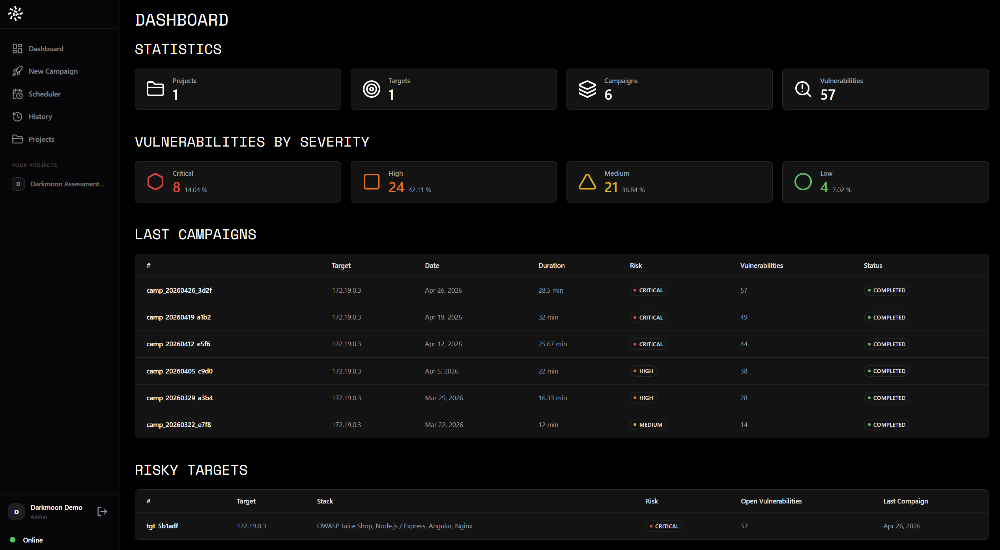

<div align="center">

<a href="https://github.com/ASCIT31/Dark-Moon"></a>

# activepieces-piece-darkmoon

### Part of [Darkmoon, the open source autonomous AI penetration testing platform](https://github.com/ASCIT31/Dark-Moon)

[](https://github.com/ASCIT31/Dark-Moon)

[](https://www.activepieces.com) [](LICENSE) [](https://dark-moon.org) [](https://dark-moon.org)

</div>

If Darkmoon is useful, a star on the [main repo](https://github.com/ASCIT31/Dark-Moon) helps others find it.

An [Activepieces](https://www.activepieces.com) community piece for [Darkmoon](https://github.com/ASCIT31/Dark-Moon), the local, privacy-first autonomous AI penetration testing engine.

<div align="center">



<sub>The Darkmoon dashboard, campaigns, severity breakdown and the findings an Activepieces flow pulls back.</sub>

</div>

It lets an Activepieces flow **trigger a Darkmoon pentest against a target you are authorised to assess, pull back the findings, and review the fix pull requests the Darkmoon Pro remediation tier prepares**, so security testing and remediation review can be wired into your automations like any other step.

> Darkmoon **runs and validates** security tests. It does not, and this piece does not, guarantee that a system is secure. Findings can include false positives and must be reviewed by a qualified human. Only run assessments against systems you own or have explicit written authorisation to test. **This piece never merges a pull request** — every fix is left for a person to review and merge.

## Actions

| Action | What it does |
| --- | --- |
| **Run Pentest** | Starts a campaign against a target. With *Wait for completion* on (default), polls to a terminal event, resolves the campaign, and returns the findings and severity stats. Optional, credential-gated remediation prepares fix pull requests during the run. |
| **Get Findings** | Returns the vulnerabilities and aggregated stats for a campaign. |
| **List Campaigns** | Returns the campaigns visible to the authenticated dashboard user. |
| **List Pull Requests** | Returns the fix pull requests Darkmoon prepared (read-only), optionally scoped to a campaign and filtered by state. |

## Connection

The piece talks to the **Darkmoon Dashboard API** (the FastAPI service shipped with Darkmoon, typically on port `8000`). Darkmoon issues a short-lived JWT from `POST /api/v1/auth/login`, so the piece logs in at run time using the stored credentials.

- **Base URL** — e.g. `http://darkmoon.internal:8000`
- **Username** / **Password** — a Darkmoon dashboard user.

The connection's validation hits the real login endpoint, so a wrong URL or bad credentials fail fast.

## Remediation & secrets

Remediation is optional and Pro-gated. When enabled it needs a **credential reference** — an *opaque id* of a credential stored in Darkmoon's encrypted vault (created in the dashboard), **not** a raw token. Raw SCM secrets never travel through this piece, and the remediation agent only ever opens a pull request for human review; it never merges.

## Install

This is a community piece distributed as its own npm package. On a self-hosted Activepieces instance, install it from the community-pieces screen (or set it as a custom piece) using the package name `activepieces-piece-darkmoon`.

## Development

```bash
npm install
npm run typecheck   # type-checks against @activepieces/pieces-framework
npm run build
npm test            # unit tests for the API client (mock transport)
```

The API client (`src/lib/client.ts`) is dependency-free and transport-injected, so its logic is unit-tested without a network. A full end-to-end run requires a running Darkmoon instance pointed at an authorised target.

## License

MIT — see [LICENSE](./LICENSE). Not affiliated with Activepieces; "Activepieces" and "n8n" are trademarks of their respective owners.
